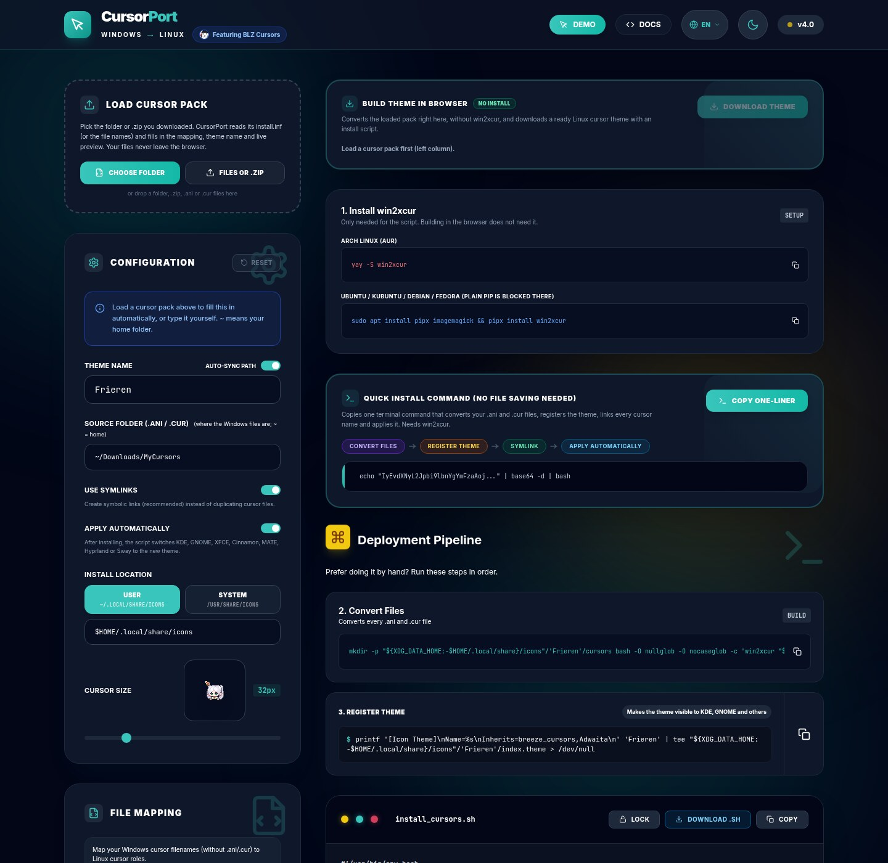

# CursorPort
[](https://opensource.org/licenses/MIT)

If you've ever tried moving your favorite Windows cursors over to Linux, you know it can be a bit of a headache. **CursorPort** is a simple, web-based tool I built to bridge that gap. It helps you take Windows animated (`.ani`) and static (`.cur`) cursors and turn them into a theme that actually works on your Linux desktop, either right in your browser or with a generated install script.

## What's new in v4

- **Build the theme in your browser** with no `win2xcur`, and download a ready `.tar.gz` with its own `install.sh`.
- **Load your pack** (folder, `.zip` or drag and drop): the mapping is read from `install.inf` or guessed from the file names.
- **`.cur` files work**: packs with only `.cur`, a mix, or upper-case extensions now convert (this fixes [#4](https://github.com/Eagle10021/Custom-Cursors-Linux/issues/4)).
- **No broken links**: the script never links a missing file, checks the result, and tells you which roles the pack doesn't have.
- **Applies itself** on KDE Plasma, GNOME, XFCE, Cinnamon, MATE, Hyprland and Sway.
- **Preview your own cursors** in the demo area, **lock** the script to keep manual edits, and **no personal defaults**.
- A new **Sources & References** section on the [documentation page](https://cursorport.01blue.org/documentation.html) lists the specs and reports behind all of this.

## What it does

- **Load your pack**: Pick the folder or `.zip` you downloaded (or drag it onto the page). CursorPort reads the pack's `install.inf` (or guesses from the file names) and fills in the role mapping, theme name and live preview for you. Your files never leave the browser.
- **Build the theme in your browser**: Converts `.ani` and `.cur` files right on the page, no `win2xcur` needed, and downloads a ready-to-install Linux cursor theme (`.tar.gz` with an `install.sh`).
- **`.ani` and `.cur` support**: Animated and static cursors, BMP and PNG frames, multiple sizes per file. The script and the manual commands handle packs with only `.ani`, only `.cur`, a mix, or upper-case extensions.
- **One script that does it all**: The generated `install_cursors.sh` converts the files, registers the theme, links 87 Linux cursor names (across 19 Windows roles) to the right files, checks for broken links and tells you which roles the pack doesn't have.
- **Applies itself**: After installing, the script switches your desktop to the new theme (KDE Plasma, GNOME, XFCE, Cinnamon, MATE, Hyprland, Sway, with a fallback for everything else). You can turn this off.
- **Live preview**: Hover the demo blocks to see your own cursors animate, or try the featured BLZ packs.
- **Edit the script safely**: Lock the script to keep your manual edits. Changing settings won't overwrite them until you hit Regenerate.
- **Distro friendly**: Arch, Ubuntu/Kubuntu, Fedora, Debian or anything else with bash.
- **Featured packs**: I've teamed up with artists like **BLZ** to include authorized demos (like the Frieren pack) right in the app.
- **Beautiful UI**: Switch between "Miku" (Dark) and "Teto" (Light) modes depending on your vibe, in English, Turkish or Chinese.
- **Remembers your work**: Your paths and mappings are saved locally, so you can pick up right where you left off.

## How to use it

### The easy way (no install)

1. **[Open CursorPort](https://cursorport.01blue.org/)**.
2. **Load your pack**: Click *Choose Folder* (or drop the folder / `.zip` on the card).
3. **Check the mapping**: Each role shows a small preview, and anything the pack doesn't have is marked.
4. **Download the theme**: Click *Download Theme* under *Build Theme in Browser*.
5. **Install it**:
   ```bash
   tar xf "MyTheme.tar.gz" && bash "MyTheme/install.sh"
   ```

### With the install script

1. Install `win2xcur` (see below).
2. Load your pack on the page (or fill in the theme name, source folder and mapping yourself).
3. Copy the one-liner, or download `install_cursors.sh` and run it as your normal user (not with `sudo`):
   ```bash
   bash install_cursors.sh ~/Downloads/MyCursors
   ```

Set `CURSORPORT_APPLY=0` before either script to install without switching to the theme.

## Prerequisites

Only the install script needs `win2xcur`. Building in the browser doesn't.

* **Arch Linux:** `yay -S win2xcur`
* **Ubuntu / Kubuntu / Debian:** `sudo apt install pipx imagemagick && pipx install win2xcur`
* **Fedora:** `sudo dnf install pipx ImageMagick && pipx install win2xcur`

Plain `pip install` is blocked on most current distros, which is why it's `pipx`.

## Fixed in v4

* **Kubuntu (and every distro): broken links after install** ([#4](https://github.com/Eagle10021/Custom-Cursors-Linux/issues/4)). The old script only converted `*.ani` files, so any cursor that came as a `.cur` was never created, and roles it couldn't find were still linked to a file that didn't exist. On a test Kubuntu 26.04 install that left 22 broken links. The new script converts both types, never links to a missing file, checks for broken links at the end, and was tested on Kubuntu 26.04 with the real `win2xcur`.

## Gallery

<p align="center">
  
  
</p>
<p align="center"><em>Light (Teto) and dark (Miku) modes in v4, with the Frieren demo pack by BLZ selected.</em></p>

## Credits & Support

* **Featured Artist:**  Big thanks to [BLZ Cursors](https://ko-fi.com/U7U6Z367V) for letting me feature their work. If you like the cursors in the demo, definitely consider supporting them on Ko-fi!
* **Contributors:** 
  * A huge shoutout to [hoangcaominh](https://github.com/hoangcaominh) for contributing a massive expansion to the symlink coverage. Thanks to their help, CursorPort now handles even more edge-case apps and desktop environments!
  * Big thanks to [fr0stb1rd](https://github.com/fr0stb1rd) for implementing the quick install one-liner (no need to download the script!) and several awesome UI tweaks.
* **Inspiration:** The UI themes are inspired by Hatsune Miku, Kasane Teto, and Akita Neru.

## License

This project is licensed under the **MIT License** - see the [LICENSE](LICENSE) file for details. Feel free to fork it, fix bugs, or contribute new features!
